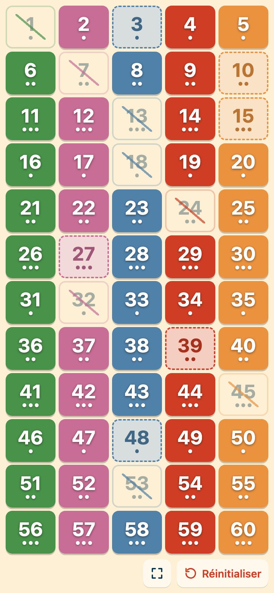
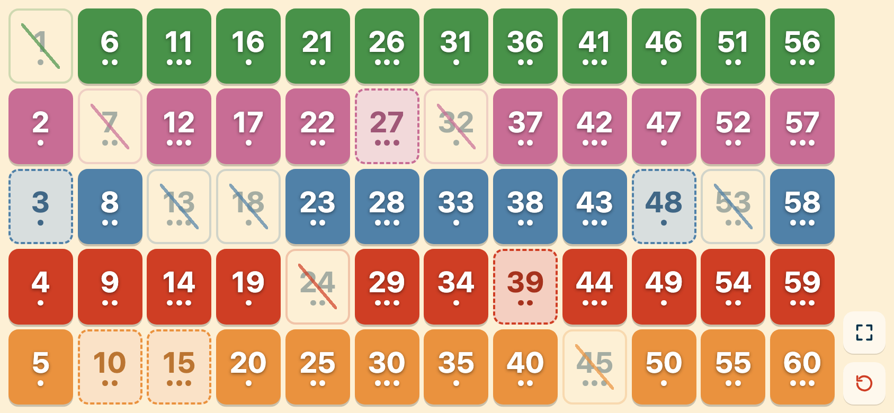

# Got Five

Application compagnon pour le jeu de société **Got Five** : un plateau de 60 nombres (5 couleurs × 12) pour suivre l'état de chaque nombre en un coup d'œil.

Pensée pour le téléphone : tout le plateau tient sur un seul écran, sans défilement, en portrait comme en paysage.

👉 **[Ouvrir l'application](https://janissedev.github.io/got-five/)**

<p align="center">
  
  &nbsp;&nbsp;
  
</p>

## Utilisation

Touchez un nombre pour faire défiler ses trois états :

1. Couleur pleine
2. Teinte claire, contour en pointillés
3. Estompé et barré

Un troisième toucher le ramène à son état de départ.

- **Réinitialiser** remet tout le plateau à zéro (après confirmation).
- La partie est **sauvegardée automatiquement** dans le navigateur : on peut fermer l'onglet et reprendre plus tard.
- L'écran reste **allumé** pendant la partie (si le navigateur le permet).

### Plein écran

- **Android** : bouton plein écran dans la barre d'outils, ou *Ajouter à l'écran d'accueil* pour l'ouvrir comme une app.
- **iPhone** : Safari ne permet pas le plein écran depuis une page web. Utilisez *Partager → Sur l'écran d'accueil* : l'app s'ouvrira alors sans barre de navigation.

## Développement

Projet [Vue 3](https://vuejs.org/) + [Vite](https://vite.dev/), état géré avec [Pinia](https://pinia.vuejs.org/) (persisté dans le `localStorage`).

```sh
npm install      # installer les dépendances
npm run dev      # serveur de développement
npm run build    # build de production dans docs/
npm run preview  # prévisualiser le build
```

### Déploiement

Le site est servi par GitHub Pages depuis le dossier `docs/` de la branche `main`, sous le chemin `/got-five/` (voir `base` dans [vite.config.js](vite.config.js)). Pour publier une nouvelle version : `npm run build`, puis commiter le dossier `docs/`.

### Structure

```
src/
├── App.vue                 # plateau, barre d'outils, dialogue de réinitialisation
├── components/Number.vue   # une case du plateau
└── stores/numbersState.js  # état des 60 nombres (0, 1 ou 2)
```
